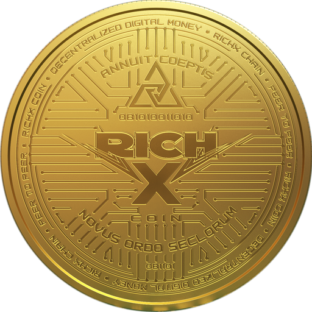
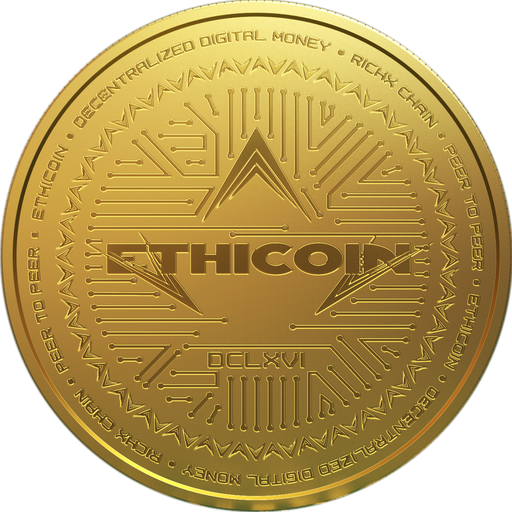
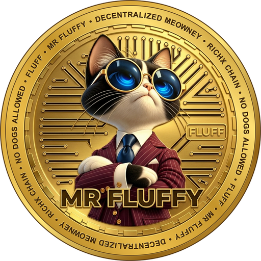
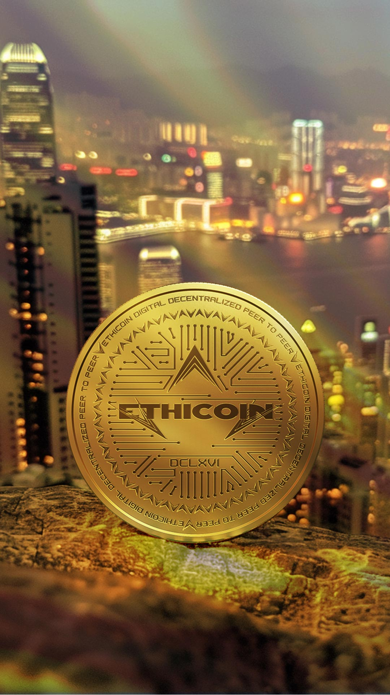
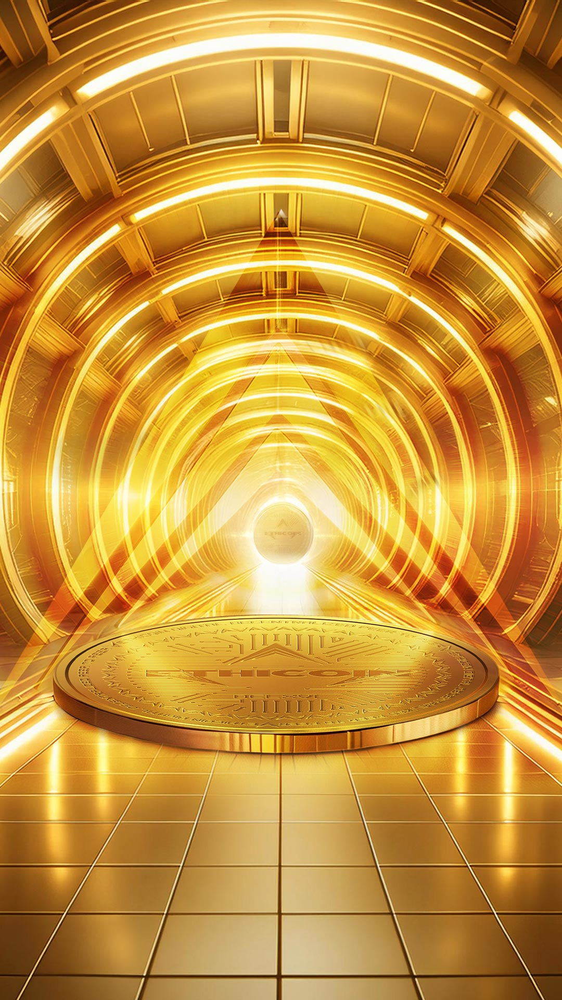
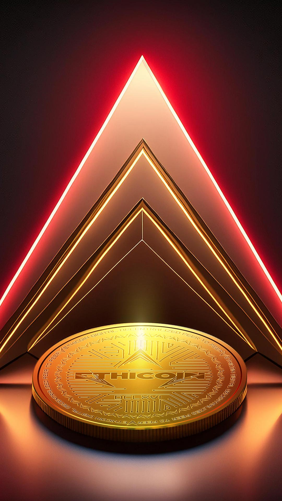
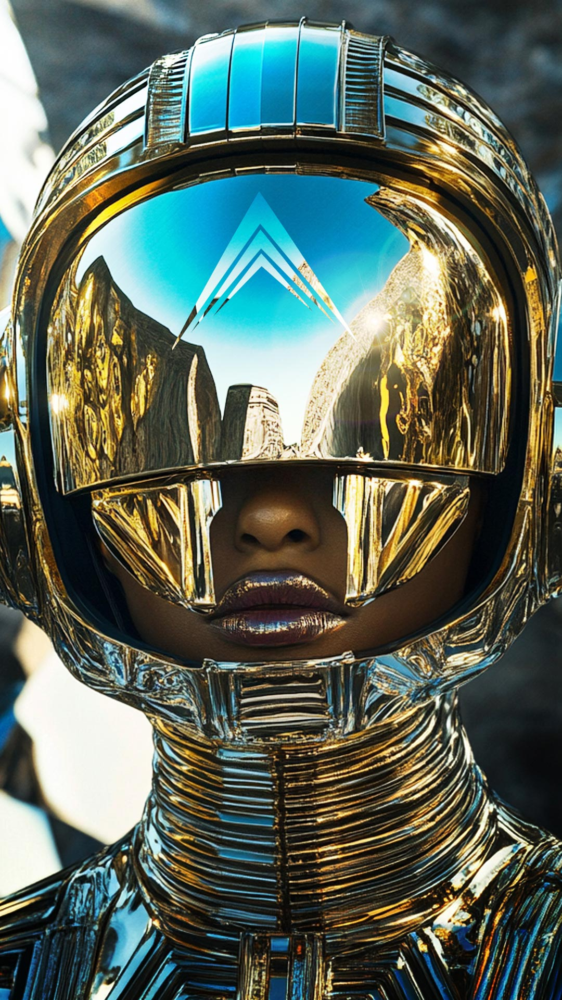

<p align="center"></p>

<h3 align="center">One chain. Four names. Everything public.</h3>

<p align="center"><a href="https://richx.finance">RichX Coin</a> · <a href="https://richxscan.com">Block explorer</a> · <a href="https://ethicoin.org">Ethicoin</a> · <a href="https://bitcoinrxc.com">Bitcoin RXC</a> · <a href="https://mrfluffycoin.com">Mr Fluffy</a></p>

```text
> RICHX CHAIN ... ONLINE
> CHAIN ID ...... 20260903
> BLOCK ......... 1,209,336
> NATIVE COIN ... RICHX
> STANDARD ...... RXC-20
> TOKENS ........ 3
> READ ON ....... 2026-11-13 06:48 UTC
```

<p align="center"></p>

<table align="center"><tr><td align="center" width="25%"><a href="tokens/richx-coin.md"><br><b>RichX Coin</b></a><br><sub>RICHX · native coin</sub></td><td align="center" width="25%"><a href="tokens/ethicoin.md"><br><b>Ethicoin</b></a><br><sub>ETHIC+ · RXC-20</sub></td><td align="center" width="25%"><a href="tokens/bitcoin-rxc.md"><br><b>Bitcoin RXC</b></a><br><sub>RBTX · RXC-20</sub></td><td align="center" width="25%"><a href="tokens/mr-fluffy.md"><br><b>Mr Fluffy</b></a><br><sub>FLUFF · RXC-20</sub></td></tr></table>

| Token | Symbol | Standard | Decimals | Contract |
|---|---|---|---|---|
| RichX Coin | RICHX | native coin | 18 | none - it is the coin of the chain |
| [Ethicoin](tokens/ethicoin.md) | ETHIC+ | RXC-20 | 9 | `0x7023Bb290be415b05491bBBaa45f4D15e4407E46` |
| [Bitcoin RXC](tokens/bitcoin-rxc.md) | RBTX | RXC-20 | 8 | `0xFcf33b5bd3Ec789cCc05Ba04388B309224eD5065` |
| [Mr Fluffy](tokens/mr-fluffy.md) | FLUFF | RXC-20 | 18 | `0x48e420AdFdff4feA0B8B043e4fe655f1d0cE09eA` |

Machine-readable: [`tokenlist.json`](tokenlist.json)

RXC-20 is the token standard on RichX Chain. It has the same interface as ERC-20.

<p align="center"></p>

| | |
|---|---|
| Network name | RichX Chain |
| Chain ID | `20260903` |
| RPC URL | `https://rpc.richxchain.com` |
| Currency symbol | `RICHX` |
| Decimals | `18` |
| Block explorer | `https://richxscan.com` |

Machine-readable: [`network.json`](network.json)

**Add RichX Chain to a wallet.** In MetaMask or any Ethereum-compatible wallet choose "Add a network manually" and enter the values above. To see a token, choose "Import token" and paste its contract address.

<p align="center"></p>

| Place | What it is | Link |
|---|---|---|
| **RichX Coin** | The native coin of the chain | https://richx.finance |
| **Block explorer** | Every block, every transaction, public | https://richxscan.com |
| **Ethicoin** | The gold-indexed token | https://ethicoin.org |
| **Bitcoin RXC** | Proof of work, 21,000,000 cap | https://bitcoinrxc.com |
| **Mr Fluffy** | The community token | https://mrfluffycoin.com |
| **RichXchange** | The exchange of RichX Chain | https://richxchange.com |
| **CERBERUS** | The AI guardian that watches RichX Chain | https://cerberus.kim |
| **RichXBridge** | Bring a token to RichX Chain | https://richxbridge.com |

<p align="center"></p>

The Ethicoin smart contract is public: [`contracts/EthicoinRichX.sol`](contracts/EthicoinRichX.sol). What it can and cannot do, in plain words: [`contracts/README.md`](contracts/README.md).

<p align="center"></p>

<table align="center"><tr><td align="center" width="33%"><a href="https://raw.githubusercontent.com/richxchain/richx-chain/main/gallery/Ethicoin-HK4.jpg"></a></td><td align="center" width="33%"><a href="https://raw.githubusercontent.com/richxchain/richx-chain/main/gallery/Ethicoin-HK2.jpg"></a></td><td align="center" width="33%"><a href="https://raw.githubusercontent.com/richxchain/richx-chain/main/gallery/Ethicoin-Gold-1.jpg"></a></td></tr><tr><td align="center" width="33%"><a href="https://raw.githubusercontent.com/richxchain/richx-chain/main/gallery/Ethicoin-HK7.jpg"></a></td><td align="center" width="33%"><a href="https://raw.githubusercontent.com/richxchain/richx-chain/main/gallery/Ethicoin-HK5.jpg"></a></td><td align="center" width="33%"><a href="https://raw.githubusercontent.com/richxchain/richx-chain/main/gallery/Ethicoin-HK6.jpg"></a></td></tr></table>

<p align="center"><a href="gallery/README.md"><b>OPEN THE WHOLE GALLERY · 27 PICTURES</b></a></p>

<p align="center"></p>

RichX Chain runs the EVM at the `london` level. Compile contracts with `evmVersion: "london"`. Newer compiler defaults use an instruction this chain does not have, and such a contract will not deploy.

<p align="center"></p>

Nobody from RichX Chain will ever ask for your seed phrase or private key. The addresses in this repository are the only official ones. Always compare the full address before you send anything.

<p align="center"></p>

<p align="center"><sub>Token names, symbols and decimals were read from the chain on 2026-11-13 06:48 UTC.</sub></p>
