<h3 align="center">The Ethicoin smart contract. Read it yourself.</h3>

| | |
|---|---|
| Source | [`EthicoinRichX.sol`](EthicoinRichX.sol) |
| Contract | `0x7023Bb290be415b05491bBBaa45f4D15e4407E46` |
| Chain | RichX Chain, ID 20260903 |
| Language | Solidity `^0.8.20` |
| EVM version | `london` |
| Code on chain | 8,855 bytes |
| SHA-256 of the code on chain | `7709423ea7bb416b7476bef9fe7a2841a611aa725d11e76f83afa4b1be40e43b` |
| Explorer | https://richxscan.com/address/0x7023Bb290be415b05491bBBaa45f4D15e4407E46 |
| Verified on the explorer | https://api.richxscan.com/api/v2/smart-contracts/0x7023Bb290be415b05491bBBaa45f4D15e4407E46 (compiler v0.8.20+commit.a1b79de6, optimizer on, EVM london) |

The code size and its fingerprint were read from the chain on 2026-11-13 06:48 UTC. Anyone can read the same code from the chain with `eth_getCode` and compare.

**It cannot create tokens.** There is no mint function. The whole supply of 1,000,000,000,000 was created once, when the contract was deployed.

**Supply can only fall.** `burn()` destroys tokens for good. `totalBurned` keeps the public count.

**No transfer fee.** Send 1,000 and the recipient receives 1,000.

**Gold-indexed, not gold-backed.** The contract holds no metal and gives no claim on metal.

**Two keys that check each other.**

| Key | Can | Cannot |
|---|---|---|
| Owner | Freeze a wallet after a public 10-minute waiting time, unfreeze it, recover tokens from a frozen wallet, pause transfers, appoint the guardian, set the per-transaction limit within fixed bounds, hand over ownership after 48 hours | Create tokens, take tokens from a wallet that is not frozen |
| Guardian | Pause and unpause all transfers at once, propose a freeze, cancel a pending change of owner | Recover tokens, change limits, take ownership, unfreeze a wallet |

Every one of these actions is a public event on the chain. There is no `selfdestruct` in the contract.

<a href="../README.md"><b>BACK TO RICHX CHAIN</b></a>

