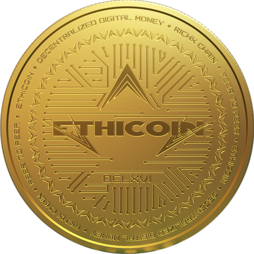

<h1 align="center">Ethicoin (ETHIC+)</h1>

Ethicoin (ETHIC+) is a gold-indexed token on RichX Chain. It is gold-indexed, not gold-backed. The project supports the clean-up of rivers in Ghana damaged by illegal gold mining.

| | |
|---|---|
| Name | Ethicoin |
| Symbol | ETHIC+ |
| Standard | RXC-20 |
| Decimals | 9 |
| Contract | `0x7023Bb290be415b05491bBBaa45f4D15e4407E46` |
| Total supply | 1,000,000,000,000 (read from the contract on 2026-11-13 06:48 UTC) |
| Chain | RichX Chain, ID 20260903 |
| Explorer | https://richxscan.com |
| Website | https://ethicoin.org |
| Verified on the explorer | https://api.richxscan.com/api/v2/smart-contracts/0x7023Bb290be415b05491bBBaa45f4D15e4407E46 (compiler v0.8.20+commit.a1b79de6, optimizer on, EVM london) |
| Contract source | [EthicoinRichX.sol](../contracts/EthicoinRichX.sol) · [what it says](../contracts/README.md) |

[Back to RichX Chain](../README.md)
