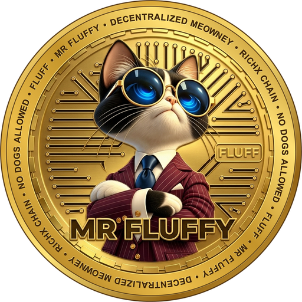

<h1 align="center">Mr Fluffy (FLUFF)</h1>

Mr Fluffy is a community token on RichX Chain. It is a plain token with no transfer fee and no owner.

| | |
|---|---|
| Name | Mr Fluffy |
| Symbol | FLUFF |
| Standard | RXC-20 |
| Decimals | 18 |
| Contract | `0x48e420AdFdff4feA0B8B043e4fe655f1d0cE09eA` |
| Total supply | 420,690,000,000,000 (read from the contract on 2026-11-13 06:48 UTC) |
| Chain | RichX Chain, ID 20260903 |
| Explorer | https://richxscan.com |
| Website | https://mrfluffycoin.com |

[Back to RichX Chain](../README.md)
